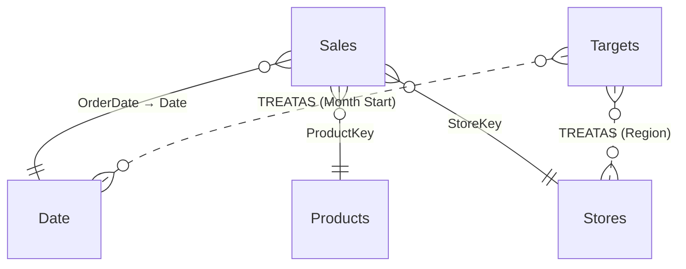
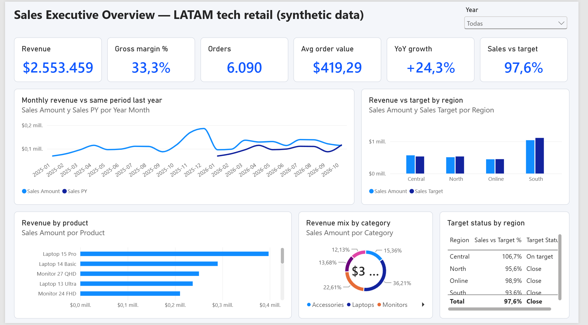
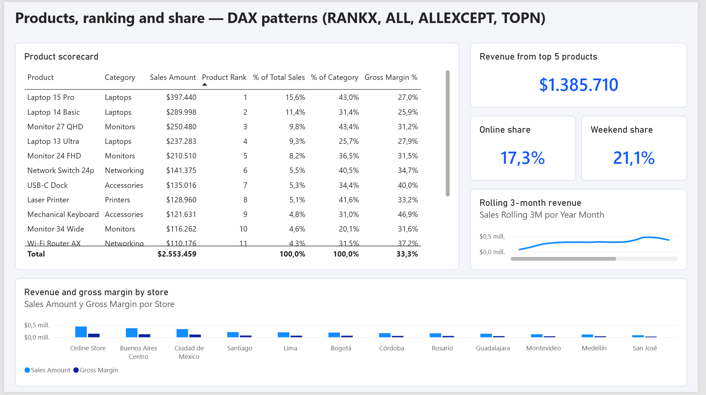
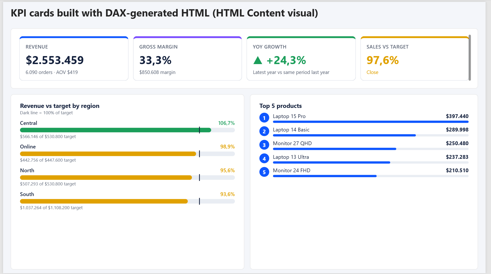

# Power BI DAX Showcase — Sales Executive Report


-217346?style=for-the-badge)


A compact Power BI project that shows how I build a **clean star-schema model** and **well-documented DAX measures** on top of it: base metrics, time intelligence, share and ranking, and targets with virtual relationships.

> Data is **synthetic** (generated with `scripts/generate_data.py`, fixed seed): a fictional tech retailer selling laptops, monitors, accessories, networking and printers across 12 LATAM stores, Jan 2025 – Oct 2026.

## Data model (star schema)



| Table | Type | Rows | Notes |
|---|---|---|---|
| `Sales` | Fact | 6,090 | Order lines: quantity, price, cost, discount |
| `Products` | Dimension | 16 | Product, category, list price |
| `Stores` | Dimension | 12 | Store, country, region, channel |
| `Date` | Calculated (DAX) | 669 | Marked as date table; ends at the last month with sales |
| `Targets` | Hidden helper | 88 | Monthly target by region, **no physical relationship** |
| `_Measures` | Measure table | — | 25 measures in 5 display folders |

Data is loaded with Power Query from CSV files through a `DataFolder` parameter.

## DAX measures (25)

| Folder | Measures | Patterns shown |
|---|---|---|
| **1. Base** | Sales Amount, Total Cost, Gross Margin, Gross Margin %, Orders, Units Sold, Avg Order Value, Discount Amount, Online Sales %, Weekend Sales % | `SUMX` row context, `DIVIDE`, `DISTINCTCOUNT`, `CALCULATE` with filter arguments |
| **2. Time intelligence** | Sales YTD, Sales MTD, Sales PY, Sales YoY %, Sales Rolling 3M | `TOTALYTD`, `TOTALMTD`, `SAMEPERIODLASTYEAR`, `DATESINPERIOD`, variables |
| **3. Share & ranking** | % of Total Sales, % of Category, Product Rank, Top 5 Products Sales | `ALL`, `ALLEXCEPT`, `RANKX` (dense), `TOPN`, `HASONEVALUE` |
| **4. Target** | Sales Target, Sales vs Target %, Target Status | **Virtual relationships with `TREATAS`**, `SWITCH(TRUE())` |
| **5. HTML** | HTML KPI Cards, HTML Region Progress, HTML Top Products | DAX that returns HTML/CSS for the *HTML Content* custom visual: `CONCATENATEX` over `TOPN` / `VALUES`, conditional colours, progress bars |

Full code of every measure: [`MEASURES.md`](MEASURES.md). Two examples:

```dax
Sales Target =
CALCULATE(
    SUM(Targets[TargetAmount]),
    TREATAS(VALUES('Date'[Month Start]), Targets[MonthStart]),
    TREATAS(VALUES(Stores[Region]), Targets[Region])
)
```

```dax
Sales YoY % =
VAR _LastYear = MAX('Date'[Year])
VAR _cy = CALCULATE([Sales Amount], 'Date'[Year] = _LastYear)
VAR _py = CALCULATE([Sales PY], 'Date'[Year] = _LastYear)
RETURN IF(NOT ISBLANK(_py), DIVIDE(_cy - _py, _py))
```

## Validation

Every measure was tested with DAX queries against the loaded model, and the base numbers were cross-checked against an independent Python calculation on the CSVs.

| Check | Result |
|---|---|
| Revenue 2025 (DAX) vs Python | **$1,335,450 = $1,335,450** ✅ |
| Revenue YoY, Jan–Oct 2026 vs Jan–Oct 2025 | **+24.3%** |
| Gross margin % | 33.3% |
| Top 5 products revenue | $1,385,710 (= sum of ranks 1–5) ✅ |
| Revenue vs target (all periods) | South 93.6% · North 95.6% · Central 106.7% · Online 98.9% |

Two bugs I caught while testing:

- `Sales YoY %` first compared the whole period against the prior year only, so the grand total showed **+160%**. It now compares the latest year with the same period of the previous year (**+24.3%**).
- `Product Rank` first used `ALL(Products[Product])`, which ranked products **inside each category** when Category was also on the visual. Switching to `ALL(Products)` gives the intended global rank.

## Report pages

1. **Overview** — year slicer, 6 KPI cards (revenue, margin %, orders, AOV, YoY, vs target), monthly revenue vs prior year, revenue vs target by region, revenue by product, category mix, target status table.
2. **Products & Ranking** — product scorecard (rank, % of total, % of category, margin), top-5 revenue, online and weekend share, rolling 3-month revenue, revenue and margin by store.
3. **KPI Cards (HTML)** — KPI cards with trend arrows and status colours, progress bars per region against target, and a top-5 leaderboard, all rendered from DAX-generated HTML.







## How to open

1. Clone the repo.
2. Open `Sales DAX Showcase.pbip` in Power BI Desktop.
   The HTML page uses the free **HTML Content** visual from AppSource; Power BI offers to add it when you open the report.
3. *Transform data → Edit parameters* → set **DataFolder** to the `data\` folder of your clone (with the trailing backslash) → Refresh.

To regenerate the CSVs: `python scripts/generate_data.py`.

## Project structure

```
data/                              synthetic CSVs (Sales, Products, Stores, Targets)
scripts/generate_data.py           data generator (fixed seed)
Sales DAX Showcase.SemanticModel/  model in TMDL (tables, relationships, measures)
Sales DAX Showcase.Report/         report definition (pages and visuals)
screenshots/                       report pages
MEASURES.md                        all DAX measures
```

---
Ramiro Di Bernardo · [LinkedIn](https://www.linkedin.com/in/ramiro-di-bernardo-142077303/) · [GitHub](https://github.com/Ramiro-DiBernardo)
